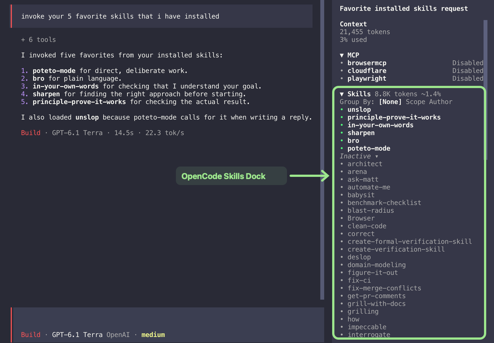

# OpenCode Skills Dock

[](https://www.npmjs.com/package/opencode-skills-dock)

An [OpenCode](https://opencode.ai/) TUI plugin that puts your skills in the session sidebar. Browse available skills, see which ones are loaded, and use them without leaving your session.



- Browse skills grouped by scope or author.
- Use a skill, copy a request, or view its details.
- See loaded and running skills, plus their estimated token count and context share.

## Install

```sh
opencode plugin add opencode-skills-dock
```

Run `/reload` in OpenCode to load the plugin. The install command adds the
package to the `plugins` array in your OpenCode CLI configuration.

## Use the skills sidebar

Open a session in OpenCode and find **Skills** in the sidebar. The section appears when skills are available.

- Select **None**, **Scope**, or **Author** next to **Group By** to change how skills are organized.
- Select a skill to use it in the current session, copy its `@` invocation, or view its details.
- Expand or collapse the skills section and its groups to control what you see. In the ungrouped view, use **Inactive** to show or hide skills that are not loaded.
- Loaded skills appear in bold. A running skill shows a spinner and a **running** label.

The token count is an estimate based on skill content length, not a tokenizer measurement. The context percentage appears when the model's context limit is available.

## Develop locally

From the repository directory, run:

```sh
bun run install:local
```

The script packs the built plugin, installs that tarball with its peer dependencies under `~/.cache/opencode-skills-dock/local` (or `$XDG_CACHE_HOME/opencode-skills-dock/local` when set), and adds the installed package path to the `plugins` array in `~/.config/opencode/cli.json` (or `$XDG_CONFIG_HOME/opencode/cli.json` when set). This exercises the same package contents and entry point as a published install. It preserves other settings and plugin entries. Run `/reload` in OpenCode to load the plugin. After editing the source, run `bun run install:local` again to rebuild and reinstall it.

Run the checks with:

```sh
bun run test
bun run typecheck
bun run test:package
```

## Contributing

See [CONTRIBUTING.md](CONTRIBUTING.md) for development and contribution guidelines. This project is licensed under the [MIT license](LICENSE).
